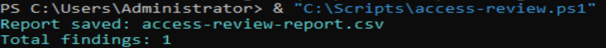
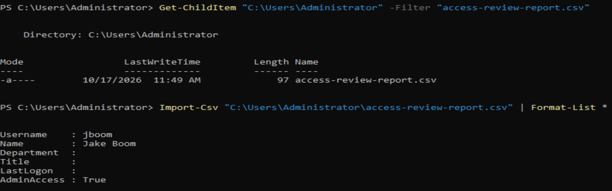

# Active Directory Access Review – Least Privilege

## Overview

As part of my IAM Security Lab, I conducted an access review of Active Directory security group memberships to identify unnecessary permissions and demonstrate the principle of least privilege.

## Access Review Findings

**Account reviewed:** `sdunce` (Sarah Dunce)

During the review, I identified that the account belonged to security groups that were not required for the user's intended role.

The unnecessary memberships included:

- `IT-Staff`
- `HR-Staff`

These memberships represented excessive access and were identified for removal.

## Remediation Performed

I removed the account from the unnecessary security groups while retaining the appropriate memberships:

- `Sales-Staff`
- `Domain Users`

I then reviewed the account's group memberships to confirm the changes.

## Evidence

The before-and-after screenshots in this folder demonstrate the account's group memberships prior to and following remediation.

## IAM Concepts Demonstrated

- Access reviews and entitlement assessment
- Role-based access control (RBAC)
- Principle of least privilege
- Identification of excessive permissions
- Access remediation and verification

## Limitations

This exercise focused on a selected lab account and its Active Directory group memberships. It does not represent a complete organisation-wide access certification or review of all effective permissions.

## Privileged Access Review – Admin-Access Group

### Objective

Identify accounts with privileged group membership that may require further investigation as part of a periodic IAM access review.

### Actions Performed

- Executed the `access-review.ps1` PowerShell script against the Active Directory lab.
- Generated an access review report containing one finding.
- Reviewed the exported CSV report.
- Identified the test account `jboom` (Jake Boom) with `AdminAccess: True`.
- Independently verified that the account belonged to the `Admin-Access` and `Domain Users` groups.

### Evidence

### Findings and Limitations

The script identified an account with privileged group membership for further review. This does not automatically indicate unauthorised access or privilege escalation.

The report did not establish whether the membership was approved, whether the account was actively used, or whether its permissions were appropriate.

No permissions were removed as part of this review.

### Outcome

Demonstrated the use of PowerShell to identify privileged group memberships, generate review findings and verify group assignments.

This exercise highlights the importance of periodic access certification, least-privilege reviews and validating privileged access against business requirements.
