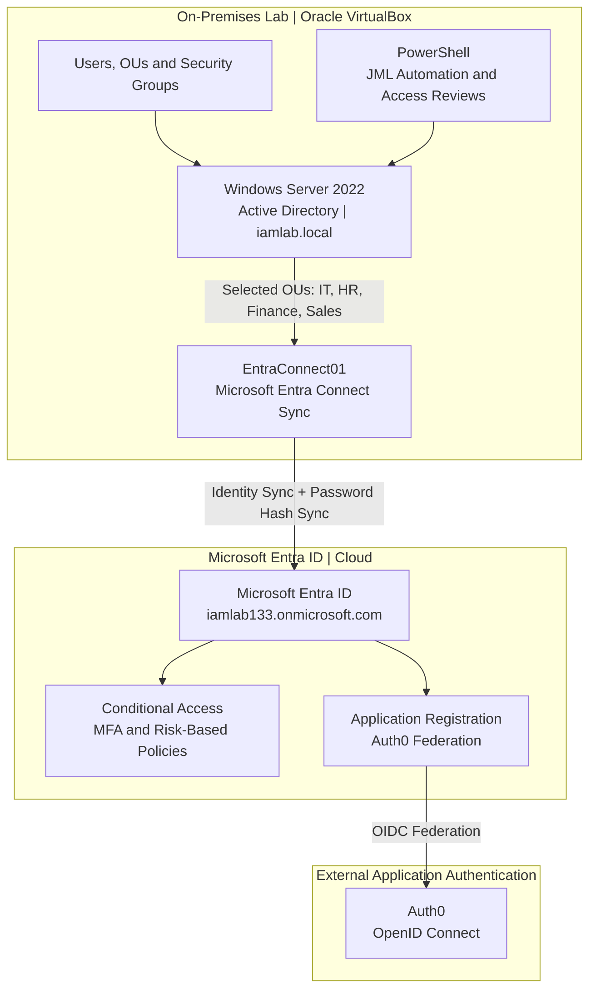

# IAM Lab Architecture

## Overview

This diagram illustrates the identity management infrastructure and authentication technologies configured within my IAM Security Lab.

The environment consists of Windows Server Active Directory, Microsoft Entra ID and Auth0, with hybrid identity synchronisation established between the on-premises and cloud directories using Microsoft Entra Connect Sync.

The architecture supports practical IAM activities including user lifecycle management, access administration, Conditional Access, multifactor authentication (MFA), PowerShell automation and federated authentication.

## Active Directory

An on-premises Active Directory environment was configured using Windows Server 2022 and the `iamlab.local` domain.

The environment includes:

- Organisational units for departmental identity management.
- User accounts and security groups.
- Service accounts for non-human identity assessments.
- PowerShell scripts supporting onboarding, offboarding and access reviews.
- Windows Security Event Logs for monitoring group membership changes.

Active Directory serves as the authoritative source for the on-premises identities synchronised to Microsoft Entra ID.

## Hybrid Identity Synchronisation

Microsoft Entra Connect Sync was installed and configured on a dedicated Windows Server 2022 virtual machine named `EntraConnect01`.

The server was joined to the `iamlab.local` domain and configured to establish synchronisation with the Microsoft Entra tenant `iamlab133.onmicrosoft.com`.

The implementation included:

- Configuring Password Hash Synchronisation (PHS).
- Applying organisational unit (OU) filtering for IT, HR, Finance and Sales.
- Configuring a test account with a Microsoft Entra-compatible User Principal Name (UPN).
- Validating directory imports and synchronisation operations.
- Troubleshooting staging mode to enable synchronisation exports.

Synchronisation Service Manager confirmed successful Full Import and Full Synchronisation operations, with 11 user objects identified in the metaverse.

A dedicated Active Directory test account, `hybridtest`, was successfully synchronised to Microsoft Entra ID.

The account's on-premises synchronisation status and identity attributes were verified through the Microsoft Entra administration portal.

This confirmed that identity synchronisation was functioning between the two directory environments.

[View Hybrid Identity Synchronisation Project](../hybrid-identity-sync/)

## Microsoft Entra ID

Microsoft Entra ID was configured to support cloud identity administration, authentication security, application registrations and access management.

Four custom Conditional Access policies were created:

| Policy | Purpose | Status |
|---|---|---|
| CA001 – Block Non-Compliant Devices | Evaluate device compliance requirements. | Report-only |
| CA002 – Require MFA – All Users | Require multifactor authentication. | On |
| CA003 – Restrict Admin Portal – Locations | Evaluate location-based restrictions for administrative access. | Report-only |
| CA004 – Require MFA – Risky Sign-ins | Require MFA for medium- and high-risk sign-ins. | On |

CA002 was tested using a dedicated account, with Microsoft Entra sign-in logs confirming successful policy application following configuration troubleshooting.

The remaining policies were configured and documented, although comprehensive enforcement testing was not completed for every scenario.

[View Conditional Access Configuration](../conditional-access/)

## Auth0 Federation

Microsoft Entra ID was integrated with Auth0 using OpenID Connect (OIDC) to test federated application authentication.

The configuration included an application registration in Microsoft Entra ID and an authentication connection within Auth0.

During testing, a Microsoft Entra ID account was prompted to register MFA before successfully completing the federated sign-in process.

This demonstrated how Microsoft Entra ID can provide authentication for an external application through federation.

The successful authentication test was limited to the selected lab account and does not confirm enforcement across all users.

## Architecture Diagram

## Key Learning Outcomes

The architecture provided practical experience with:

- Active Directory identity and group administration.
- Hybrid identity integration between Active Directory and Microsoft Entra ID.
- Microsoft Entra Connect Sync configuration and troubleshooting.
- Password Hash Synchronisation and OU filtering.
- Identity attribute mapping and synchronisation validation.
- Conditional Access and MFA configuration.
- Federated authentication using OpenID Connect.
- PowerShell automation for identity lifecycle administration.
- Security event monitoring and access reviews.

A key part of this project was understanding how the different identity platforms interact, particularly how on-premises accounts are synchronised to Microsoft Entra ID and how cloud identities can be used for application authentication.

## Scope and Limitations

This architecture represents a controlled IAM lab environment developed for practical learning and technical demonstration.

Hybrid identity synchronisation was successfully implemented and verified using a dedicated test account.

However, the lab does not represent a production-ready identity infrastructure. Comprehensive testing of synchronisation failure scenarios, Conditional Access enforcement, disaster recovery and identity lifecycle changes across both directories remains outside the completed project scope.

The architecture demonstrates the configured components, their relationships and the identity management processes tested within the lab.
