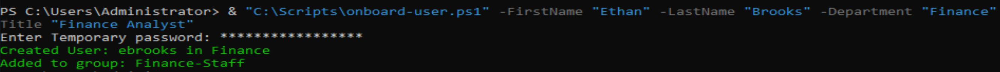
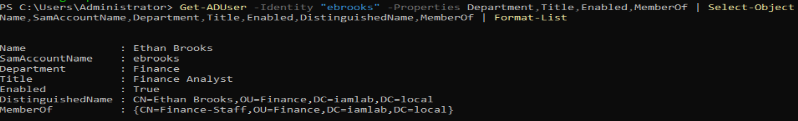
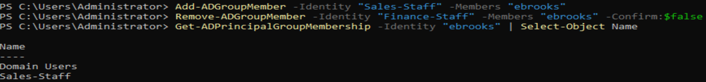
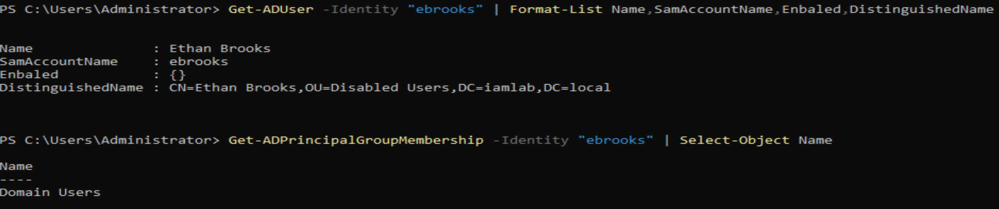

# Exercise 1 – Full Employee Lifecycle Simulation
 
## Overview

This exercise demonstrates the management of an employee's identity and access throughout the Joiner, Mover and Leaver (JML) lifecycle using Windows Server Active Directory and PowerShell.

The objective was to provision a new employee account, update access following a departmental transfer, and securely deprovision the account when the employee leaves.

## Environment

- **Platform:** Windows Server Active Directory
- **Domain:** `iamlab.local`
- **Tools:** PowerShell and Active Directory PowerShell module
- **Test account:** Ethan Brooks (`ebrooks`)
- **Departments:** Finance and Sales

## 1. Joiner – User Onboarding

**Objective:** Create a new employee account and assign the appropriate departmental access.

**Actions performed:**
- Executed the onboarding PowerShell script to create `ebrooks`.
- Assigned the account to the Finance organisational unit (OU).
- Configured the user's department as Finance and job title as Finance Analyst.
- Added the account to the `Finance-Staff` security group.

**Verification:** Confirmed the account was enabled and reviewed its Active Directory attributes and group membership.

**Evidence:**

## 2. Mover – Department Transfer

**Objective:** Update an employee's access following a transfer from Finance to Sales.

**Actions performed:**
- Changed the user's department to Sales and job title to Sales Executive.
- Moved the account from the Finance OU to the Sales OU.
- Added the user to the `Sales-Staff` security group.
- Removed the previous `Finance-Staff` group membership to prevent unnecessary access retention.

**Verification:** Confirmed that the account belonged to `Sales-Staff` and `Domain Users`, with no remaining `Finance-Staff` membership.

**Evidence:**

## 3. Leaver – User Offboarding

**Objective:** Revoke an employee's access when they leave the organisation.

**Actions performed:**
- Executed the offboarding PowerShell script against `ebrooks`.
- Disabled the Active Directory account.
- Removed the user's departmental security group membership.
- Moved the account into the `Disabled Users` OU.

**Verification:** Confirmed that the account was disabled and located in the `Disabled Users` OU. A separate group membership check showed only `Domain Users` remaining.

**Evidence:**

## Key IAM Principles Demonstrated

- **Identity lifecycle management:** Managing identities through joining, changing roles and leaving.
- **Role-based access control (RBAC):** Assigning departmental access through security groups.
- **Least privilege:** Removing access that is no longer required after a departmental transfer.
- **Access deprovisioning:** Disabling accounts and removing departmental access during offboarding.
- **PowerShell automation:** Using scripts to support repeatable identity administration.
- **Verification and audit evidence:** Checking Active Directory account states and memberships after changes.

## Limitations and Future Improvements

- The exercise was performed in an isolated lab environment using fictional accounts.
- The onboarding script requires improved error handling to ensure success messages are displayed only after successful account creation.
- Further improvements could include additional input validation, structured logging, approval workflows and automated post-execution verification.
- The exercise demonstrates Active Directory lifecycle operations; it does not establish automated synchronisation with Microsoft Entra ID.

## Outcome

Successfully demonstrated the Joiner, Mover and Leaver lifecycle for a test employee, including account provisioning, departmental access changes, removal of obsolete permissions and account deprovisioning.

The exercise provides practical evidence of foundational Identity and Access Management operations.
