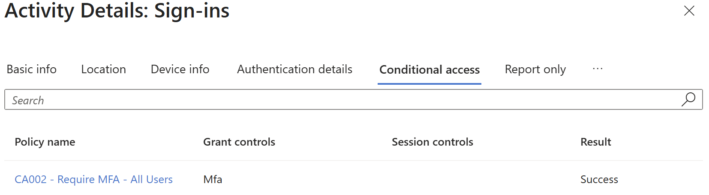

# Exercise 2 – Conditional Access Testing

## Overview

This exercise demonstrates the configuration, testing and troubleshooting of Microsoft Entra ID Conditional Access policies in an IAM lab environment.
 
The objective was to validate MFA requirements for a test user and investigate policy evaluation results using Microsoft Entra sign-in logs.

## Environment

- **Platform:** Microsoft Entra ID
- **Test account:** IAM Test1
- **Policy tested:** CA002 - Require MFA - All Users
- **Grant control:** Require multifactor authentication
- **Tools:** Microsoft Entra admin center, sign-in logs and Conditional Access policy evaluation

## 1. Initial Test – Policy Not Applied

During the initial authentication test, the test account successfully completed MFA.

However, the Conditional Access sign-in logs showed that CA002 had not applied.

Further investigation of the policy evaluation details identified the following:

- **Policy state:** Enabled
- **User assignment:** Not matched
- **Reason:** Direct exclusion
- **Resource:** Matched

This demonstrated that completing MFA does not necessarily mean a particular custom Conditional Access policy was responsible for the authentication requirement.

## 2. Troubleshooting and Remediation

The test account had previously been excluded from CA002.

The exclusion was removed, and a subsequent sign-in was performed after allowing time for the policy configuration to take effect.

## 3. Successful Policy Validation

The new sign-in event was reviewed in Microsoft Entra sign-in logs.

The Conditional Access tab confirmed:

- **Policy:** CA002 - Require MFA - All Users
- **Grant control:** MFA
- **Result:** Success

This confirmed that CA002 applied to the test sign-in and that its MFA requirement was satisfied.

### Evidence

## 4. Additional Policies and Limitations

The wider IAM lab also includes Conditional Access policies covering device compliance, administrator access restrictions and risky sign-ins.

These configurations are documented separately in the repository's `conditional-access/` folder.

The successful CA002 test does not establish that every other policy was tested or enforced.

Another Microsoft-managed MFA policy also returned Success during the test, so the evidence does not establish that CA002 was solely responsible for the MFA prompt.

## Key IAM Skills Demonstrated

- Conditional Access policy configuration
- MFA policy validation
- Sign-in log analysis
- Troubleshooting policy exclusions
- Understanding user and resource assignments
- Evidence-based security testing

## Outcome

Successfully identified why a custom MFA policy was not applying to a test account, corrected the exclusion configuration and verified that the policy applied successfully during a subsequent sign-in.
