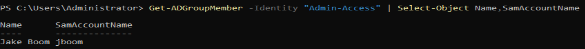
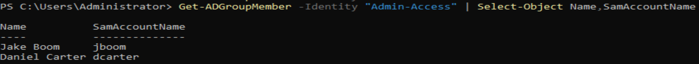
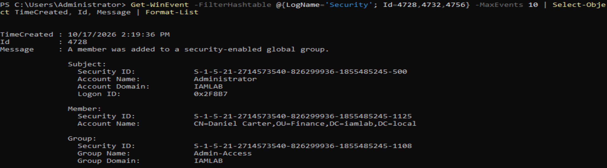
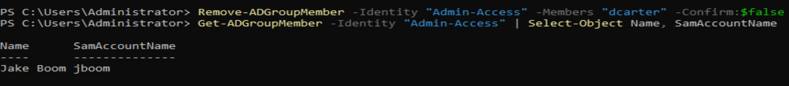

# Exercise 3 – Privilege Escalation Detection

## Overview

This exercise demonstrates the simulation, detection, investigation and remediation of an unauthorised privileged group membership change in a Windows Server Active Directory lab.

The objective was to identify an unexpected change to a security group, investigate the associated Windows Security event and restore the original group membership.

## Lab Environment

- **Platform:** Windows Server Active Directory
- **Domain:** `iamlab.local`
- **Tools:** PowerShell, Active Directory PowerShell module and Windows Security Event Logs
- **Security group:** `Admin-Access`
- **Test account:** Daniel Carter (`dcarter`)
- **Existing group member:** Jake Boom (`jboom`)

## 1. Establishing the Baseline

The existing membership of the `Admin-Access` security group was reviewed using PowerShell.

The initial check confirmed that Jake Boom (`jboom`) was the only member.

```powershell
Get-ADGroupMember -Identity "Admin-Access" |
Select-Object Name, SamAccountName
```

**Evidence:**



## 2. Simulated Unauthorised Privilege Change

A controlled security scenario was performed by adding Daniel Carter (`dcarter`) to the `Admin-Access` group.

```powershell
Add-ADGroupMember -Identity "Admin-Access" -Members "dcarter"
```

The group membership was then checked again, confirming that both Jake Boom and Daniel Carter were members.

**Evidence:**



## 3. Detection and Investigation

Windows Security Event Logs were queried using PowerShell to identify group membership changes.

```powershell
Get-WinEvent -FilterHashtable @{LogName='Security'; Id=4728,4732,4756} -MaxEvents 10 |
Select-Object TimeCreated, Id, Message |
Format-List
```

A relevant event was identified with the following details:

| Field | Finding |
|---|---|
| Event ID | 4728 |
| Event description | Member added to a security-enabled global group |
| Account added | Daniel Carter |
| Target group | Admin-Access |
| Change performed by | Administrator |
| Event timestamp | 17 October 2026, 14:19:36 |

The event provided an audit trail showing which account performed the change, which user was added and which group was affected.

**Evidence:**



## 4. Remediation and Verification

Following the investigation, Daniel Carter was removed from the `Admin-Access` group.

```powershell
Remove-ADGroupMember -Identity "Admin-Access" -Members "dcarter" -Confirm:$false
```

The group membership was checked again:

```powershell
Get-ADGroupMember -Identity "Admin-Access" |
Select-Object Name, SamAccountName
```

The verification confirmed that Daniel Carter was no longer a member and that Jake Boom remained the only member.

**Evidence:**



## Key IAM and Security Skills Demonstrated

- Privileged access monitoring
- Active Directory security group administration
- Windows Security Event Log investigation
- PowerShell-based security auditing
- Detection of unexpected access changes
- Least-privilege remediation
- Post-remediation verification

## Limitations

- This was a controlled simulation using fictional accounts in an isolated Active Directory lab.
- The group membership change was intentionally performed by the lab administrator; it was not a real attack or confirmed compromise.
- The exercise demonstrates manual detection through security event analysis, not automated alerting or continuous monitoring.
- Membership in the custom `Admin-Access` group does not, by itself, establish Domain Admin privileges or confirm the group's effective permissions.

## Outcome

Successfully simulated a privileged group membership change, identified the corresponding Windows Security Event ID 4728, investigated the affected account and group, and removed the additional membership.

The exercise demonstrates practical skills in privileged access investigation, Active Directory auditing and access remediation.
