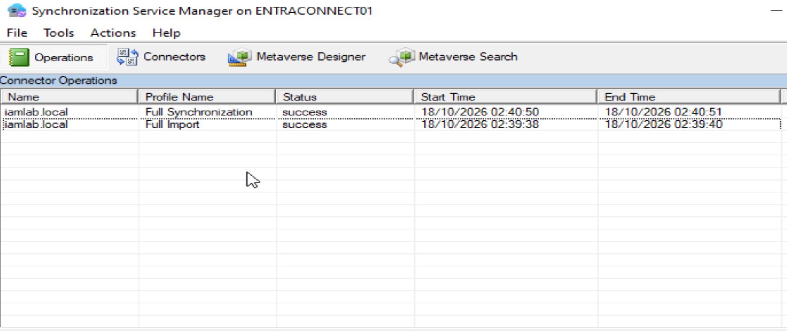
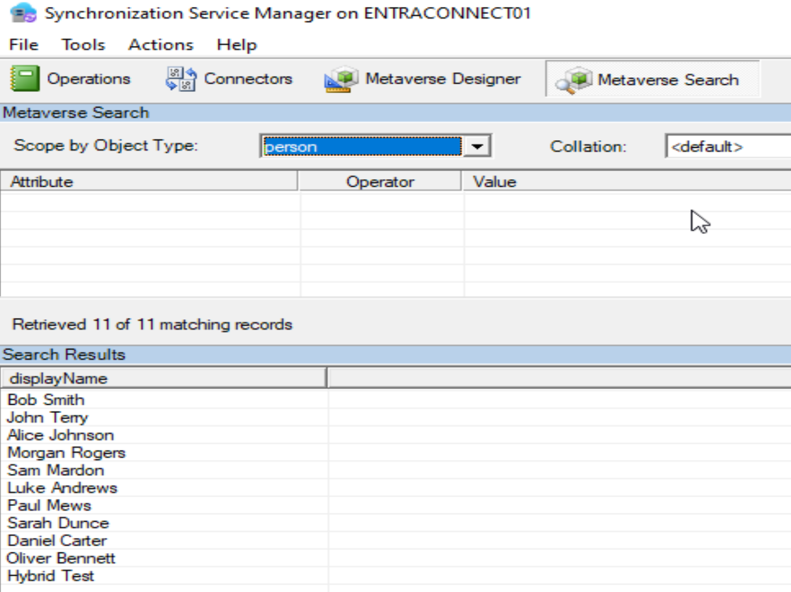
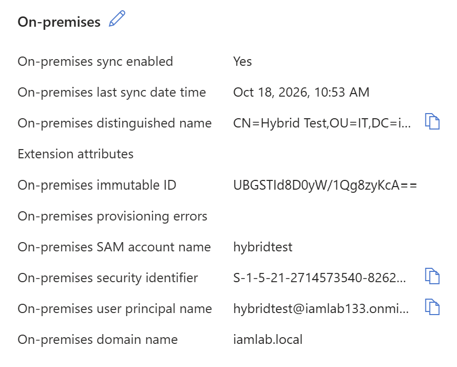

# Hybrid Identity Synchronisation | Active Directory & Microsoft Entra ID

## Project Overview

This project involved implementing and validating hybrid identity synchronisation between an on-premises Active Directory environment and Microsoft Entra ID using Microsoft Entra Connect Sync.

The objective was to establish a functional hybrid identity environment, enabling selected on-premises identities to be provisioned into Microsoft Entra ID while maintaining Active Directory as their authoritative identity source.

The implementation focused on directory integration, synchronisation scoping, identity attribute configuration, troubleshooting and verification.

## Objectives

- Establish connectivity between on-premises Active Directory and Microsoft Entra ID.
- Deploy and configure Microsoft Entra Connect Sync on a dedicated server.
- Implement organisational unit (OU) filtering to control the scope of synchronised identities.
- Configure Password Hash Synchronisation (PHS).
- Validate directory imports and synchronisation operations.
- Troubleshoot synchronisation issues and verify successful cloud provisioning.

## Lab Environment

| Component | Configuration |
|---|---|
| Domain Controller | Windows Server 2022 (TestLab) |
| Active Directory Domain | `iamlab.local` |
| Synchronisation Server | Windows Server 2022 (EntraConnect01) |
| Cloud Identity Platform | Microsoft Entra ID |
| Microsoft Entra Tenant | `iamlab133.onmicrosoft.com` |
| Synchronisation Tool | Microsoft Entra Connect Sync |
| Authentication Method | Password Hash Synchronisation |
| Synchronisation Scope | Finance, HR, IT and Sales OUs |
| Virtualisation Platform | Oracle VirtualBox |

## Implementation

### 1. Infrastructure Preparation

Provisioned a dedicated Windows Server 2022 virtual machine to host Microsoft Entra Connect Sync.

Configured network connectivity between the synchronisation server and the on-premises domain controller, including internal network addressing and DNS resolution.

Joined the synchronisation server to the `iamlab.local` Active Directory domain and verified connectivity to Microsoft Entra ID.

### 2. Microsoft Entra Connect Configuration

Installed Microsoft Entra Connect Sync using the custom installation option.

Configured the connection between the on-premises Active Directory forest and the Microsoft Entra tenant, selecting Password Hash Synchronisation as the authentication method.

Applied OU filtering to restrict synchronisation to four departmental organisational units:

- Finance
- HR
- IT
- Sales

This approach provided greater control over the identities included in synchronisation and excluded unnecessary system containers, service accounts and other out-of-scope objects.

### 3. Identity Configuration and Validation

Created a dedicated test account, `hybridtest`, within the IT organisational unit.

Configured the account's User Principal Name (UPN) to use the verified Microsoft Entra tenant domain, `iamlab133.onmicrosoft.com`, rather than the non-routable on-premises `.local` suffix.

Used Synchronisation Service Manager to perform Full Import and Full Synchronisation operations.

Validated that 11 user objects were present in the synchronisation metaverse, confirming that the configured identities had been imported and processed by the synchronisation engine.

## Troubleshooting

### Synchronised Identities Not Appearing in Microsoft Entra ID

**Issue**

Although directory import and synchronisation operations completed successfully, the expected identities were not appearing in Microsoft Entra ID.

**Investigation**

Reviewed the synchronisation configuration and identified that the server was operating in staging mode.

Staging mode allows the synchronisation engine to import and process identity changes while preventing those changes from being exported to connected directories.

**Resolution**

Disabled staging mode through the Microsoft Entra Connect configuration wizard and enabled the synchronisation process.

Subsequently verified that the test identity was successfully provisioned into Microsoft Entra ID.

This highlighted the distinction between successful local synchronisation processing and successful export to the cloud directory.

## Validation & Evidence

### 1. Successful Synchronisation Operations

Verified successful Full Import and Full Synchronisation operations against the on-premises Active Directory connector.

### 2. Identity Processing in the Metaverse

Confirmed that 11 user objects were present in the metaverse, including the dedicated hybrid identity test account.

### 3. Hybrid Identity Verification in Microsoft Entra ID

Verified the synchronised `hybridtest` account in Microsoft Entra ID, confirming:

- On-premises synchronisation enabled.
- Source Active Directory domain: `iamlab.local`.
- On-premises SAM account name: `hybridtest`.
- Source organisational unit: IT.
- Recorded last synchronisation timestamp.

These attributes confirmed that the account was successfully provisioned from the on-premises directory into Microsoft Entra ID.

## Outcome

Successfully established and validated hybrid identity synchronisation between Active Directory Domain Services and Microsoft Entra ID.

The implementation demonstrated the ability to deploy and configure Microsoft Entra Connect Sync, apply identity synchronisation controls, investigate configuration issues and validate identity provisioning across on-premises and cloud environments.

The completed exercise provides practical exposure to hybrid identity administration and operational responsibilities relevant to IAM Analyst and IAM Engineering roles.

## Key Learnings

- **Hybrid identity architecture:** Developed a practical understanding of how on-premises Active Directory integrates with Microsoft Entra ID through a dedicated synchronisation server.
- **Identity scoping:** Applied OU filtering to control which directory objects were eligible for synchronisation.
- **Identity attributes:** Gained experience configuring UPN suffixes for compatibility with a verified Microsoft Entra domain.
- **Synchronisation troubleshooting:** Identified the impact of staging mode on directory exports and resolved the issue.
- **Operational validation:** Used Synchronisation Service Manager and Microsoft Entra ID to distinguish successful local processing from confirmed cloud provisioning.

## Further Development

Potential extensions to the project include validating password-based cloud authentication, testing user lifecycle changes between directories, and exploring synchronisation monitoring and error handling.

---

**Project Status:** Completed — Hybrid Identity Synchronisation Verified

**Environment:** Isolated IAM Security Lab
