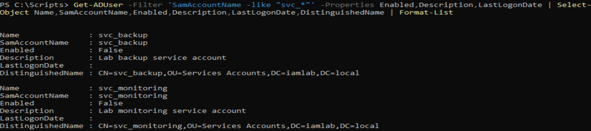
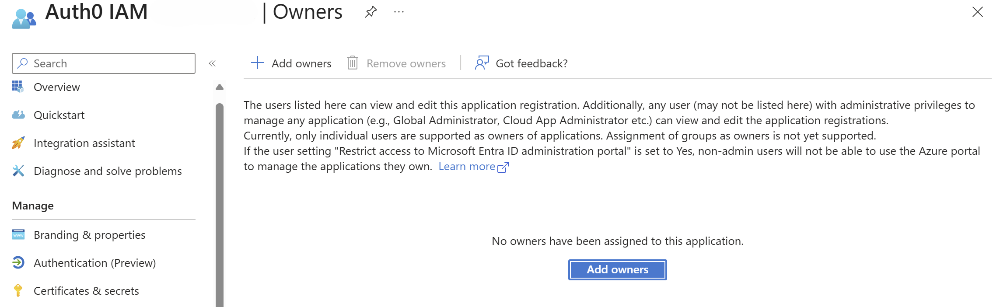
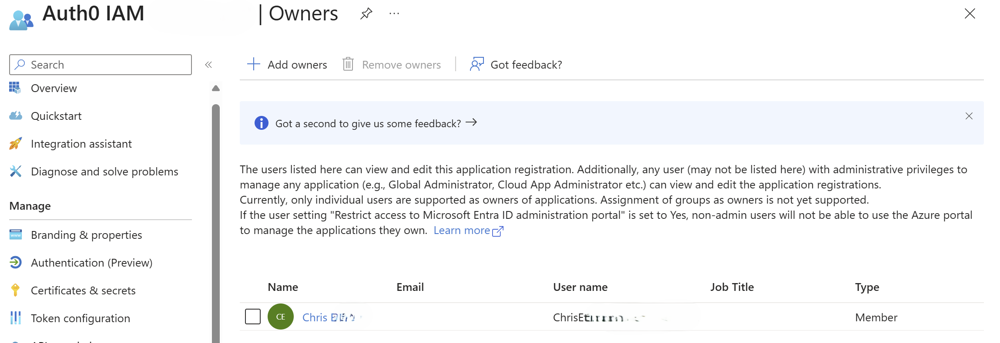

# Non-Human Identity Security Review

## Overview

As part of my IAM Security Lab, I conducted a security review of non-human identities across Active Directory and Microsoft Entra ID.

The assessment focused on service account ownership, application registration security, credential management and potential identity governance risks.

The objective was to identify configuration weaknesses, document security findings and apply remediation where appropriate.

## 1. Active Directory Service Accounts

Two Active Directory service accounts were reviewed:

- `svc_backup`
- `svc_monitoring`

### Assessment

The accounts were examined to establish their current status, ownership information and potential security concerns.



### Findings

The review identified the following:

- Both service accounts were disabled.
- Neither account had an assigned owner recorded in the `ManagedBy` attribute.
- No password last-set date was recorded in the assessment. This can happen when an account is created without a password being set or with "must change password at next logon" enabled, but the cause was not confirmed.
- Account dependencies and historical authentication activity were not fully investigated.
- The accounts' continued operational requirements could not be confirmed.

Although the accounts were disabled, the absence of documented ownership and verified dependencies presented an identity governance concern.

### Recommendations

- Assign accountable owners to service accounts.
- Document each account's purpose and operational requirements.
- Investigate authentication activity and service dependencies.
- Review assigned permissions and group memberships.
- For any account that is still needed, assess whether a group Managed Service Account (gMSA) would be appropriate, so that password management is handled automatically.
- Remove accounts that are no longer required after confirming that deletion will not disrupt services.

### Follow-up checks (not yet performed)

The following checks would close the open items above:

```powershell
# Ownership, password state, last activity, SPNs and group memberships
Get-ADUser -Identity svc_backup -Properties ManagedBy, PasswordLastSet, PasswordNeverExpires, LastLogonDate, ServicePrincipalName, MemberOf, Created
Get-ADUser -Identity svc_monitoring -Properties ManagedBy, PasswordLastSet, PasswordNeverExpires, LastLogonDate, ServicePrincipalName, MemberOf, Created
```

Scheduled tasks and Windows services on relevant servers should also be checked for references to either account before any decommissioning decision.

### Remediation Status

**Assessment completed — further investigation required.**

The accounts were not deleted because their operational dependencies had not been fully assessed.

This approach was taken to avoid removing identities that could still be associated with existing services or scheduled tasks.

## 2. Microsoft Entra ID Application Identity

**Application:** Auth0 IAM Federation

### Assessment

The Microsoft Entra ID application registration used for Auth0 federation was reviewed to assess application ownership, permissions and credential configuration.

### Findings

The review identified:

- The application registration initially had no assigned owner.
- The application had delegated Microsoft Graph `User.Read` permission.
- A client secret was configured for application authentication.
- The client secret had an expiry date of 4 September 2027.

The missing application owner represented an accountability gap, as no individual was explicitly assigned responsibility for the application's configuration and ongoing maintenance.

The configured permission and client secret were also reviewed as part of the assessment. Their presence alone was not considered evidence of a security vulnerability.

**Before remediation:**



### Remediation

The lab administrator was assigned as the application owner.

The updated ownership configuration was subsequently verified in Microsoft Entra ID.

This addressed the identified ownership gap within the lab environment.

**After remediation:**



In a production tenant, a named service owner would be assigned, plus a second owner so that accountability survives staff changes.

### Additional Recommendations

- Review application permissions regularly and remove unnecessary access.
- Confirm that delegated permissions align with the application's intended functionality.
- Monitor client secret expiry dates, assign someone responsible for rotation, and keep secret lifetimes short.
- Consider certificate credentials instead of client secrets where the integration supports them.
- Use secure credential storage rather than embedding secrets in scripts or documentation.
- Review application ownership whenever responsibilities change.

### Remediation Status

**Application ownership remediated.**

The application owner was assigned and verified. Broader credential lifecycle management and automated monitoring were identified as areas for future development.

## 3. Security Findings Summary

Severity ratings are my own assessment for this lab context.

| Finding | Risk / Concern | Severity | Status |
|---|---|---|---|
| Application registration without an owner | Application governance and accountability gap | Medium | Remediated |
| Service accounts without documented owners | Unclear accountability and ownership | Low (accounts are disabled) | Further investigation required |
| Service account dependencies not verified | Potential disruption if accounts are removed | Low | Not remediated |
| Application client secret expiry | Credential lifecycle management requirement | Low (expires September 2027) | Documented |
| Microsoft Graph delegated permission | Requires periodic least-privilege review | Low (`User.Read` only) | Reviewed |

## 4. Key Learning Outcomes

This exercise provided practical experience with:

- Reviewing Active Directory service account configurations.
- Identifying gaps in non-human identity ownership.
- Assessing the risks associated with potentially unused accounts.
- Understanding the importance of verifying dependencies before account removal.
- Reviewing Microsoft Entra ID application registrations.
- Assessing application permissions and credential expiry.
- Applying remediation to application ownership.
- Documenting security findings and outstanding recommendations.

One of the main takeaways was that non-human identity security involves more than identifying unused accounts or credentials.

Establishing ownership, understanding operational dependencies and maintaining appropriate permissions are important parts of managing service accounts and application identities securely.

## 5. Scope and Limitations

This assessment was completed within a controlled IAM lab environment.

The review covered two Active Directory service accounts and one Microsoft Entra ID application registration.

Application ownership remediation was successfully completed and verified.

Both reviewed service accounts were disabled, so the review did not cover the higher-risk cases found in real environments: enabled service accounts with non-expiring passwords, Service Principal Names (SPNs) that expose them to Kerberoasting, or membership of privileged groups.

Service account dependencies, historical authentication activity, effective permissions and automated credential rotation were not comprehensively tested.

The findings therefore represent the configurations and evidence reviewed during the exercise rather than a complete non-human identity security assessment.
